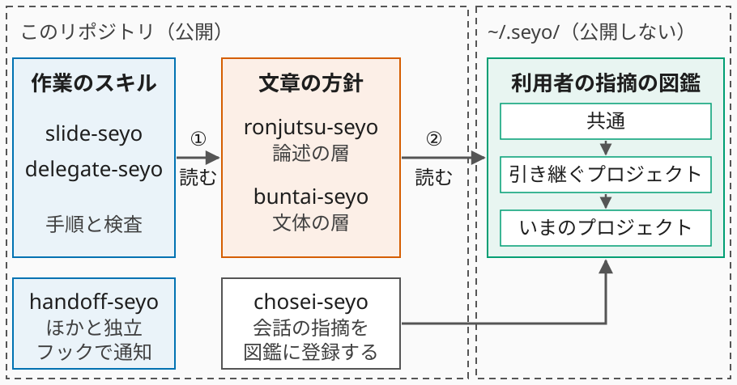

# seyo-skills

seyo-skills は、AI エージェントが書く日本語の文章（スライド、委譲の指示書、継続書、報告など）の質を上げるための 7 つのスキルです。文章の方針を二つの層（論述と文体）に分けて持ち、利用者がこれまでに出した指摘の原文もエージェントに読ませます。一度出した指摘は、あとの会話と別のエージェントに引き継がれます。

## 導入

コマンド 1 つで入ります。対話の画面で、入れるスキルとエージェント（Claude Code、Codex など）を選びます。

```
npx skills add surumenDD/seyo-skills -g
```

Claude Code だけで使う場合は、プラグインとしても入れられます。

```
/plugin marketplace add surumenDD/seyo-skills
/plugin install seyo@seyo-skills
```

入れたら、新しいセッションで「slide-seyo で、〇〇を 3 枚のスライドにして」のように、スキルの名前を出して頼みます。二つの入れ方の違い、handoff-seyo のフックの設定、更新と削除は[導入の手引き](docs/install.md)にあります。



| スキル | 何をするか | 頼み方の例 |
|---|---|---|
| slide-seyo | スライドの作成・修正・点検と、可読性の検査 | 「slide-seyo で、この deck.pdf を点検して」 |
| delegate-seyo | 作業の委譲の指示書と、結果の確認 | 「delegate-seyo で、並行して調べさせて」 |
| handoff-seyo | 長い作業の継続書と、再開時の読み直し | 「handoff-seyo で継続書を書いて」 |
| kowake-seyo | 案や論点が多いときに、一件ずつ議論して決める | 「kowake-seyo で、この修正案を一件ずつ相談させて」 |
| ronjutsu-seyo | 論述の層。何をどの順で主張するか | 「ronjutsu-seyo で、この節を直して」 |
| buntai-seyo | 文体の層。語・文・表記を文書の種類ごとに | 「buntai-seyo で、この README を直して」 |
| chosei-seyo | 会話で出た指摘を、原文の図鑑に取り込む | 「chosei-seyo で取り込んで」 |

## 最初の 1 回の試し方

1. 新しいセッションを開き、表の頼み方の例のように、スキルの名前を出して頼みます。たとえば「slide-seyo で、この README をもとに 5 枚の紹介スライドを作って」と頼むと、エージェントはまず構成案（発表全体の主張、見出し、証拠の示し方）を示して返答を待ちます。指摘がなければスライドを作成し、検査スクリプトで測ります。HTML の検査には Node と `npm install` が要ります（[前提](#前提)）。準備がなければ、エージェントは検査を実行できなかったことと、必要なものを報告します。
2. エージェントの文章や進め方に指摘をしたら、同じ会話で「chosei-seyo で取り込んで」と頼みます。エージェントは会話から指摘を取り出し、図鑑に登録する件の案を示します。了承すると、原文が `~/.seyo/projects/<プロジェクト>/genten.md` に登録されます。次からは、文章を書くエージェントがこの図鑑を読みます。

7 つのスキルはどれも、名前を出して頼まれたときだけ使うよう、説明文で指定しています。例外は次の三つです。

- ronjutsu-seyo・buntai-seyo・delegate-seyo は、ほかのスキルの手順からも読まれます。
- handoff-seyo は、フックの知らせでも使われます。
- kowake-seyo は、案や論点が多いときにエージェントが提案し、利用者が了承すると使われます。

Claude Code では説明文を一覧から外す設定もあり、一覧の分量を減らせます（[導入の手引き](docs/install.md#スキルの一覧に名前だけを出す)）。

## 仕組み

作業の手順は誰が使っても同じですが、何を良い文章とするかは、文書の種類と人で異なります。そこでこのスキル集は、三つに分けて持ちます。

| 置き場 | 中身 | 誰にとっても同じか |
|---|---|---|
| 作業のスキル（slide-seyo、delegate-seyo など） | 作業の手順と検査 | 同じ |
| 二つの層（ronjutsu-seyo、buntai-seyo） | 文書の種類ごとの基準 | 同じ |
| 図鑑（利用者の PC の `~/.seyo/`） | その利用者が出した指摘の原文 | 利用者ごと |

作業のスキルは、文章を書く場面に来ると、文書の種類を指定して二つの層を読ませます。

| 作業のスキル | 文章を書く場面 | 層を読むときの文書の種類 |
|---|---|---|
| slide-seyo | 構成案、スライドの文言と発表原稿 | 発表（スライドと台本） |
| delegate-seyo | 委譲の指示書 | AI 向けの文書（指示書、スキルの本体） |
| delegate-seyo | 委譲の結果の報告 | 報告、説明の返答 |

論述の層は何をどの順で主張するかを、文体の層は語・文・表記の選び方を、文書の種類ごとに定めます。文書の種類は、論文、発表、報告、メール、README などです。層を入れていない置き場でも、slide-seyo は発表に欠かせない最低限の規則を自分で持っています。

図鑑は、AI の文章や進め方への利用者の指摘を原文のまま集めた文書です。プロジェクトごとに利用者の PC の `~/.seyo/` に置かれ、このリポジトリには入りません。エージェントは二つの層を読んだあとに、図鑑を共通、引き継ぐプロジェクト、いまのプロジェクトの順に読みます。図鑑の指摘と層の既定が食い違うときは、その利用者については図鑑が優先します。図鑑が無ければ、層だけで書きます。図鑑を作り、指摘を足すのは chosei-seyo です。

handoff-seyo は、層も図鑑も読まずに働きます。コンテキストの使用率が閾値（既定 90%）を超えたときと、文脈の圧縮の直後に、フックがエージェントに知らせます。エージェントは継続書を書くかを検討するか、継続書を読み直します。

## 測定で分かっていること

作者 1 人の記録（論文の推敲と発表の準備で AI の文章に出した指摘）を使い、層と、指摘を言い換えてまとめた文書を別のモデルに渡して測りました。今の図鑑の形（原文を引く形）は、まだ測っていません。

- 新しい材料の草稿を書き直させると、利用者が指摘した問題の解消率は 12.8% から 26.6% に上がりました（差の 95% の区間は +0.3〜+30.2 ポイント）。27 件中 18 件は解消しませんでした。
- 取り込んだあとの新しい材料に利用者が出す指摘は、予測できませんでした（+3.0 ポイント、95% の区間は 0 を含む）。
- 文章の確認に使うと、利用者が直さなくてよいと決めた箇所を問題として挙げる件が増えました（18 か所中 3 → 7）。
- 言い換えてまとめた文書が、原文を読ませる方法を上回った測定はありませんでした。図鑑が原文を引くのは、このためです。

数値の条件と試験の手順は、[ronjutsu-seyo の README](skills/ronjutsu-seyo/README.md#測定で分かっていること) と [harness/PROCEDURE.md](harness/PROCEDURE.md) にあります。

## 前提

| 使うもの | 要るもの |
|---|---|
| すべてのスクリプト | Python 3。標準ライブラリだけで動きます |
| slide-seyo の PDF の検査 | Python 3.9 以上と、`skills/slide-seyo/scripts/requirements.txt` のパッケージ（pypdfium2、numpy） |
| slide-seyo の HTML の検査 | Node と、`skills/slide-seyo/scripts` での `npm install`、Chrome か Edge |
| slide-seyo の .pptx の PDF への書き出し（`export_pdf.ps1`） | Windows と PowerPoint。ほかの環境では、使っているツールで PDF に保存して渡します |
| slide-seyo の図の調査（任意） | 調査のスキル imozuru（MaryCache/imozuru）。入っていなければ、通常の検索で調べます |
| handoff-seyo のフック | Claude Code と、`python` というコマンドで起動する Python 3 |
| handoff-seyo の使用率の値 | ステータス行のスクリプトへの追記。作者が確かめたのは Windows の PowerShell だけです。追記が無い環境では、環境変数 `HANDOFF_CTX_WINDOW` に窓のトークン数を設定します。どちらも無いと、フックは知らせません |

macOS や Linux には、`python3` だけがあり `python` が無い環境があります。その環境では handoff-seyo のフックが起動せず、知らせが出ません。対処とほかの OS での状況は、[導入の手引きの前提](docs/install.md#前提)にあります。この README と手引きのコマンドの `python` も、その環境では `python3` に読み替えてください。

## 更新と削除

| 入れ方 | 更新 | 削除 |
|---|---|---|
| `npx skills` | `npx skills update -g` | `npx skills remove -g`（外すスキルを選ぶ） |
| プラグイン | `claude plugin update seyo@seyo-skills` | `/plugin uninstall seyo@seyo-skills` |

`settings.json` とステータス行のスクリプトに手で足した設定は、削除のあとに手で消します。`~/.seyo/` の図鑑は残るので、不要なら削除してください。詳しい手順は[導入の手引き](docs/install.md#更新)にあります。

## 開発

リポジトリを clone して手元で編集しながら使う場合は、`python tools/link.py` で、`skills/` の下のフォルダをエージェントの置き場に結びます。`python tools/check.py` は、全スキルの自己テスト、説明文の形式、文書が指すファイルの有無を検査します。どちらも[導入の手引き](docs/install.md)に説明があります。

## ライセンス

MIT ライセンスです（[LICENSE](LICENSE)）。
