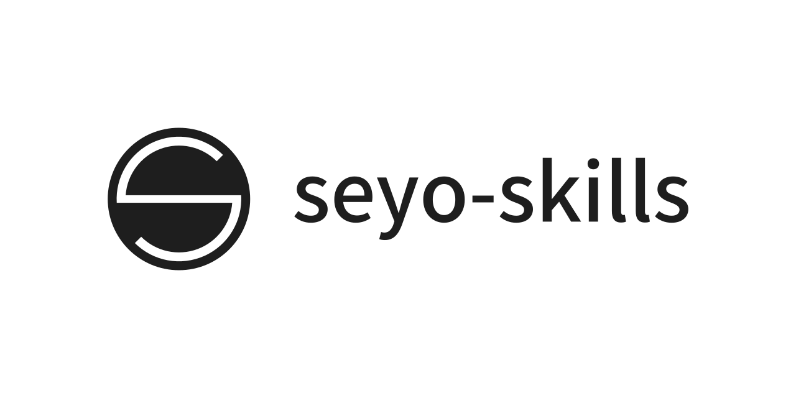
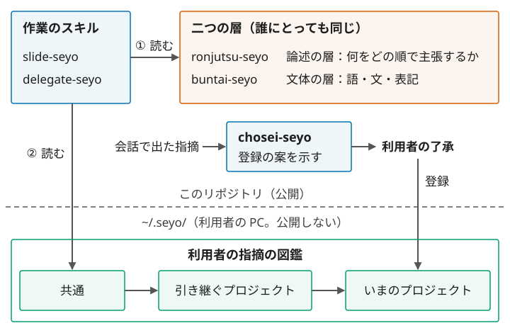

# 

AI エージェントが書く日本語を、読み手に伝わる文章に整えるスキル集です。スライド、委譲の指示書、継続書、報告など、AI に日本語を書かせる作業で使います。

## 何が変わるか

エージェントは、書く前に文章の方針を読みます。たとえば次のように変わります。

| 対象 | 変わる前 | 変わった後 | 効いた規則 |
|---|---|---|---|
| スライドの見出し | サーバーを一つ登録して、認証する | alphaXiv MCP は mcp add コマンドで登録でき、Claude Code ではブラウザで、Codex では API キーで認証する | 見出しにはそのスライドの主張を一文で書く（slide-seyo） |
| 指示書の一文 | 第 1 節は種類を問わず当て、第 2 節は選んだ種類の項を重ねる。 | 第 1 節はすべての文書に適用する。第 2 節は、該当する種類の項を併せて適用する。 | 定着した語を和語の動詞に言い換えない（buntai-seyo） |

利用者が出した指摘は、chosei-seyo に取り込みを頼むと、原文のまま図鑑に登録されます。登録の前に、案を示して了承を得ます。以後は、次の会話のエージェントも別のエージェントも、図鑑を読んでから書きます。同じ指摘を何度も出さずに済みます。

## 導入

```
npx skills add surumenDD/seyo-skills -g
```

対話の画面で、入れるスキルとエージェント（Claude Code、Codex、Cursor など）を選びます。

<details>
<summary>Claude Code のプラグインとして入れる</summary>

```
/plugin marketplace add surumenDD/seyo-skills
/plugin install seyo@seyo-skills
```

スキルの名前は `seyo:<名前>` の形になります。`npx skills` とプラグインの両方で入れると、同じスキルが二重に読み込まれます。どちらか一方にしてください。

</details>

handoff-seyo のフックの設定と、更新と削除は[導入の手引き](docs/install.md)にあります。

## 使い方

スキルの名前を出して頼みます。

```
slide-seyo で、この README をもとに 5 枚の紹介スライドを作って
delegate-seyo で、この調査を並行して進めさせて
chosei-seyo で、さっきの指摘を取り込んで
```

slide-seyo は、まず構成案（発表全体の主張、見出し、証拠の示し方）を示して返答を待ちます。指摘がなければスライドを作成し、可読性を検査スクリプトで測ります。chosei-seyo は、図鑑に登録する件の案を示し、了承を得てから登録します。

どのスキルも、名前を出して頼まれたときだけ使われます。例外は次の三つです。

- ronjutsu-seyo・buntai-seyo・delegate-seyo は、ほかのスキルの手順からも読まれます。
- handoff-seyo は、フックの知らせでも使われます。
- kowake-seyo は、案や論点が多いときにエージェントが提案し、利用者が了承すると使われます。

## スキルの一覧

| スキル | 何をするか | こんなときに |
|---|---|---|
| slide-seyo | 発表スライドの作成・修正・点検と、可読性の検査 | 発表の資料を作る、直す、点検する |
| delegate-seyo | 委譲の指示書の書き方と、結果の確かめ方 | 調査や作業をサブエージェントに任せる |
| handoff-seyo | 長い作業の継続書と、再開時の読み直し | 文脈の圧縮や次のセッションに備える |
| kowake-seyo | 案や論点を一件ずつ議論して決める | 修正案が多く、一度に判断できない |
| ronjutsu-seyo | 論述の層。何をどの順で主張するか | 論文、報告、メールの筋を直す |
| buntai-seyo | 文体の層。語・文・表記を文書の種類ごとに | README や報告の文を直す |
| chosei-seyo | 会話で出た指摘を、原文の図鑑に取り込む | 出した指摘を次の会話にも引き継ぐ |

## 仕組み

<picture>
  <source media="(prefers-color-scheme: dark)" srcset="assets/overview-dark.svg">
  
</picture>

何を良い文章とするかは、文書の種類と人で異なります。そこでこのスキル集は、方針を三つの置き場に分けて持ちます。

| 置き場 | 中身 | 利用者による違い |
|---|---|---|
| 作業のスキル | 作業の手順と検査 | 無い |
| 二つの層 | 文書の種類ごとの基準。論述の層は何をどの順で主張するかを、文体の層は語・文・表記を定める | 無い |
| 図鑑 | その利用者が出した指摘の原文 | 利用者ごと |

作業のスキルは、文章を書く場面で文書の種類を指定し、二つの層を読ませます。そのあと、図鑑を読ませます。図鑑の指摘と層の既定が食い違うときは、その利用者については図鑑を優先します。図鑑が無ければ、層だけで書きます。層を入れていない置き場でも、slide-seyo は発表に欠かせない最低限の規則を自分で持っています。

handoff-seyo は、層も図鑑も読まずに働きます。コンテキストの使用率が閾値（既定 90%）を超えたときと文脈の圧縮の直後に、フックがエージェントに知らせます。

## 図鑑の置き場と公開の範囲

図鑑は利用者の PC の `~/.seyo/` に、プロジェクトごとに置かれます。このリポジトリには入りません。エージェントが書くときに読み込むので、使っているモデルの提供元には送られます。chosei-seyo は、指摘を取り込む作業で Web 検索とそれ以外の外部のサービスを使いません。不要になったら `~/.seyo/` を削除してください。

## 測定で分かっていること

作者 1 人の記録（論文の推敲と発表の準備で、AI の文章に出した指摘）を使い、層と、指摘を言い換えてまとめた文書を別のモデルに渡して測りました。

- 新しい材料の草稿を書き直させると、利用者が指摘した問題の解消率は 12.8% から 26.6% に上がりました（差の 95% の区間は +0.3〜+30.2 ポイント）。27 件中 18 件は解消しませんでした。
- 取り込んだあとの新しい材料に利用者が出す指摘は、予測できませんでした（+3.0 ポイント、95% の区間は 0 を含む）。
- 文章の確認に使うと、利用者が直さなくてよいと決めた箇所を問題として挙げる件が増えました（18 か所中 3 → 7）。
- 言い換えてまとめた文書が、原文を読ませる方法を上回った測定はありませんでした。図鑑が原文を引くのは、このためです。

今の図鑑の形（原文を引く形）と、今回書き直した層は、まだ測っていません。数値の条件と試験の手順は、[ronjutsu-seyo の README](skills/ronjutsu-seyo/README.md#測定で分かっていること) と [harness/PROCEDURE.md](harness/PROCEDURE.md) にあります。

## 前提

| 使うもの | 要るもの |
|---|---|
| すべてのスクリプト | Python 3。標準ライブラリだけで動きます |
| slide-seyo の PDF の検査 | Python 3.9 以上と、`skills/slide-seyo/scripts/requirements.txt` のパッケージ（pypdfium2、numpy） |
| slide-seyo の HTML の検査 | Node と、`skills/slide-seyo/scripts` での `npm install`、Chrome か Edge |
| slide-seyo の .pptx の PDF への書き出し（`export_pdf.ps1`） | Windows と PowerPoint。ほかの環境では、使っているツールで PDF に保存して渡します |
| slide-seyo の図の調査（任意） | 調査のスキル imozuru（MaryCache/imozuru）。入っていなければ、通常の検索で調べます |
| handoff-seyo のフック | Claude Code と、`python` というコマンドで起動する Python 3 |
| handoff-seyo の使用率の値 | ステータス行のスクリプトへの追記か、環境変数 `HANDOFF_CTX_WINDOW`（窓のトークン数）。どちらも無いと、フックは知らせません |

macOS や Linux には、`python3` だけがあり `python` が無い環境があります。その環境では handoff-seyo のフックが起動しません。対処は[導入の手引きの前提](docs/install.md#前提)にあります。この README と手引きのコマンドの `python` も、その環境では `python3` に読み替えてください。

## 更新と削除

| 入れ方 | 更新 | 削除 |
|---|---|---|
| `npx skills` | `npx skills update -g` | `npx skills remove -g`（外すスキルを選ぶ） |
| プラグイン | `claude plugin update seyo@seyo-skills` | `/plugin uninstall seyo@seyo-skills` |

`settings.json` とステータス行のスクリプトに手で足した設定は、削除のあとに手で消します。`~/.seyo/` の図鑑は残ります。詳しい手順は[導入の手引き](docs/install.md#更新)にあります。

## 開発

リポジトリを clone して手元で編集しながら使う場合は、`python tools/link.py` で、`skills/` の下のフォルダをエージェントの置き場に結びます。`python tools/check.py` は、全スキルの自己テスト、説明文の形式、文書が指すファイルの有無を検査します。

## ライセンス

MIT ライセンスです（[LICENSE](LICENSE)）。
